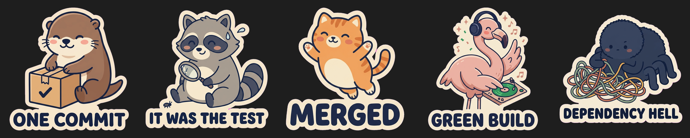
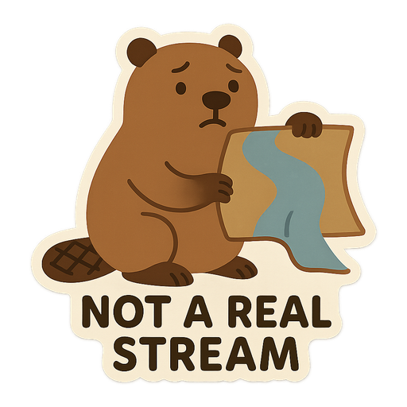
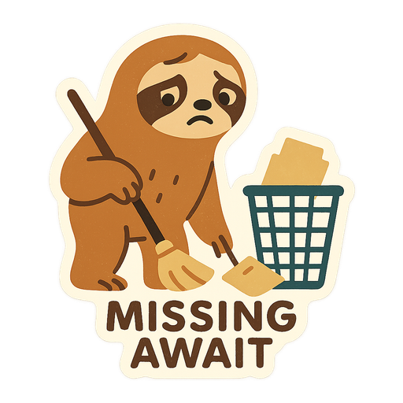

# Stickr

Turn your coding sessions into stickers.

Fixed a stubborn bug? Finally got a green build? Ask your coding agent for a sticker. Stickr picks a moment from the conversation, draws it, and copies a transparent PNG to your clipboard. Paste it into WhatsApp, Slack, or Messages.



## Install

**npm installation is coming soon.** For now, run from a local checkout with Node.js 22+ and pnpm:

```bash
git clone https://github.com/eliasadamshk/stickr.git
cd stickr
pnpm install
pnpm build
pnpm link --global
stickr setup
```

Setup installs the skill into detected Codex and Claude Code installations and helps you save your image-provider API key in your operating system's credential store. OpenAI is the default; you can also use `OPENAI_API_KEY` from your environment.

To use Google Gemini instead, run `stickr setup --provider gemini` with a Gemini API key, or set `GEMINI_API_KEY`. Image generation uses your provider account and requires available credits or billing.

## Make a sticker

Do some coding, then invoke Stickr:

- **Claude Code:** `/stickr`
- **Codex:** `$stickr`, or select Stickr from `/skills`

Your agent chooses the subject and caption from the session. You can also ask for a mascot, such as `/stickr with the otter`.

The recurring cast: **otter, raccoon, cat, flamingo, and spider**. Set a favorite with `stickr setup --character otter`, or reset it with `stickr setup --character none`.

Add your own mascots, and your agent picks them up automatically:

```bash
stickr characters                       # built-in and custom mascots
stickr characters add hedgehog --description "a round brown hedgehog with soft spines and a cream face"
stickr characters edit hedgehog --description "..."
stickr characters remove hedgehog
```

Custom characters live in `~/.stickr/characters.json` and are drawn in the same mascot style as the built-in cast. Run `stickr setup` again after upgrading so your agent learns about them.

### From real debugging sessions

| A cardboard stream fooled the API | A missing await caused a test race |
| :---: | :---: |
|  |  |

## Your sticker library

Every sticker is saved in `~/.stickr/stickers/<id>/`: a full-quality `original.png`, a 512×512 `sticker.png`, and a messaging-friendly `sticker.webp`.

```bash
stickr list             # recent stickers
stickr open <id>        # preview
stickr copy <id>        # copy again
stickr reveal <id>      # show in your file manager
stickr inspect <id>     # metadata and image details
stickr --help           # all commands and options
```

## Settings and privacy

Defaults live in `~/.stickr/config.json`:

```json
{
  "autoCopy": true,
  "provider": "openai",
  "character": "otter"
}
```

Omit `character` to let your agent choose a subject. Set `autoCopy` to `false` to save stickers without copying. Use `STICKR_HOME` for a different storage directory and `STICKR_DEBUG=1` for troubleshooting.

Stickr sends the invented visual description to the image provider. It does not automatically send your source code, diffs, or terminal history. The session summary stays in local metadata. API keys come from your environment or operating system's credential store.

Clipboard copying works on macOS and Linux; Linux needs `wl-copy` or `xclip`. On other platforms, copy the saved file manually. Linux credential storage needs `libsecret-tools`; environment variables work without it.

## Development

```bash
just ci          # locked install, lint, typecheck, tests, build, and audit
just --list      # individual commands
```

Non-prerelease GitHub Releases trigger the [npm publish workflow](.github/workflows/release.yml). The tag must match `package.json`, for example `v0.1.0` for version `0.1.0`.
